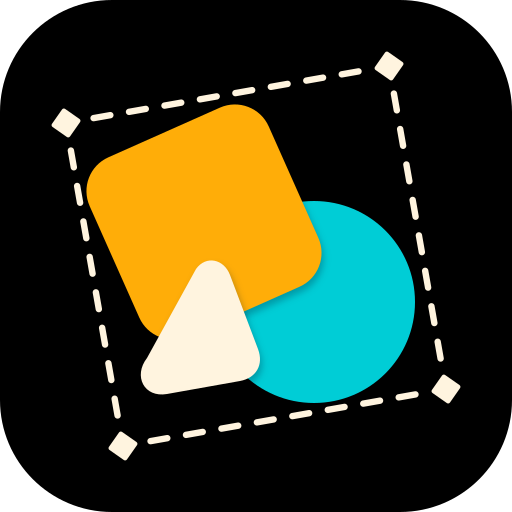
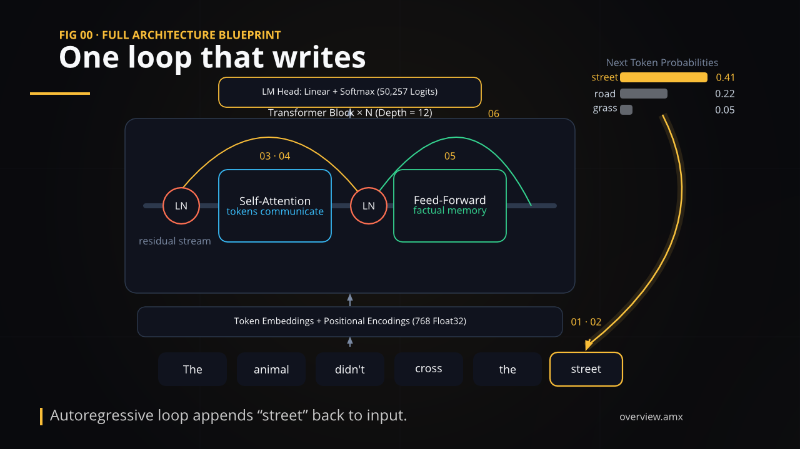

<p align="center">
  
</p>
<h1 align="center">Animatix</h1>
<p align="center"><strong>Scenes in code. Stories in motion.</strong></p>
<p align="center">A declarative language for explanatory animations, built in Rust.</p>
<p align="center">
  <a href="https://amx.j4ger.dev/showcase/"><strong>See it in motion ↗</strong></a>
  &nbsp; · &nbsp;
  <a href="https://amx.j4ger.dev/learn/">Language tour</a>
  &nbsp; · &nbsp;
  <a href="docs/README.md">Documentation</a>
</p>

<p align="center">
  <a href="https://amx.j4ger.dev/demos/transformer/">
    
  </a>
  <br>
  <sub>Made with Animatix. <a href="https://amx.j4ger.dev/demos/transformer/">View archived example →</a></sub>
</p>

## A scene in a few lines

Describe the scene, then say what changes and when.

```animatix
config { colorscheme: "editorial-dark", resolution: (1280, 720) }

title: Text, text: "ANIMATIX", font_size: 96, color: text.primary, anchor: scene.center
accent: Rect, size: (60, 3), color: accent.primary, anchor: scene.center, offset: (0, -80)

#0.5s
fade_in(target: title, duration: 1s, ease: ease_out)
fade_in(target: accent, duration: 800ms)
accent.size = (640, 3) [800ms, ease: ease_out]
```

## Try it locally

See [GitHub Releases](https://github.com/j4ger/animatix/releases) for available builds. The nightly workflow packages a Linux x86-64 development snapshot. For runtime dependencies and portability, see [Downloaded builds](docs/contributing.md#downloaded-builds). Use the Nix shell below to build from source.

<details>
<summary><strong>Build from source with Nix</strong></summary>

With [Nix](https://nixos.org/download/) and flakes enabled, open the hello scene:

```sh
git clone https://github.com/j4ger/animatix.git
cd animatix
nix develop
cargo run --bin animatix-gui -- examples/basics/00_hello.amx
```

For CLI rendering, video export, and other build setups, see the [development guide](docs/contributing.md).

</details>

---

[Contributing](CONTRIBUTING.md) · [MIT license](LICENSE)
