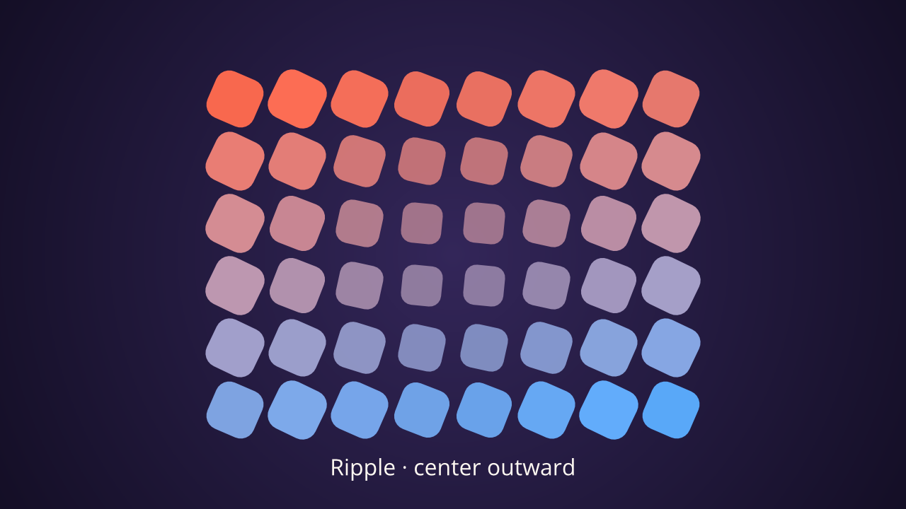

<p align="center">
  
</p>
<h1 align="center">Animatix</h1>
<p align="center"><strong>Scenes in code. Stories in motion.</strong></p>
<p align="center">A declarative language for explanatory animations, built in Rust.</p>
<p align="center">
  <a href="https://amx.j4ger.dev/showcase/"><strong>See it in motion ↗</strong></a>
  &nbsp; · &nbsp;
  <a href="https://amx.j4ger.dev/learn/">Language tour</a>
  &nbsp; · &nbsp;
  <a href="docs/README.md">Documentation</a>
</p>

<p align="center">
  <a href="https://amx.j4ger.dev/showcase/ripple-and-cascade/">
    
  </a>
  <br>
  <sub>Ripple and Cascade. <a href="https://amx.j4ger.dev/showcase/ripple-and-cascade/">Play it live →</a></sub>
</p>

## A scene in a few lines

Describe the scene, then say what changes and when.

```animatix
config { colorscheme: "editorial-dark", canvas_size: (1280, 720) }

title: Text, text: "ANIMATIX", font_size: 96, color: text.primary, anchor: scene.center
accent: Rect, size: (60, 3), color: accent.primary, anchor: scene.center, offset: (0, -80)

#0.5s
fade_in(target: title, duration: 1s, ease: ease_out)
fade_in(target: accent, duration: 800ms)
accent.size = (640, 3) [800ms, ease: ease_out]
```

## Examples

[Open the online examples](https://amx.j4ger.dev/#examples) or [browse the same AMX files](web/content/scenes/).

## Try it locally

See [GitHub Releases](https://github.com/j4ger/animatix/releases) for available builds. The nightly workflow packages a Linux x86-64 development snapshot. For runtime dependencies and portability, see [Downloaded builds](docs/contributing.md#downloaded-builds). Use the Nix shell below to build from source.

Start with a narrated explainer, a math explainer, or a metric brief. Animatix Studio, the native workbench, and `animatix init` offer the same templates. [First project instructions](docs/contributing.md#start-from-a-built-in-template)

<details>
<summary><strong>Build from source with Nix</strong></summary>

With [Nix](https://nixos.org/download/) and flakes enabled, open the first tutorial scene:

```sh
git clone https://github.com/j4ger/animatix.git
cd animatix
nix develop
cargo run --bin animatix-gui -- web/content/scenes/first-move.amx
```

For CLI rendering, video export, and other build setups, see the [development guide](docs/contributing.md).

</details>

## AI-assisted authoring (preview)

Codex finds the [project skills](.agents/skills/) when opened in this repository.
Use `$animatix-explainer` to draft and storyboard a complete explanation, or
`$animatix-scene` to turn a settled brief into AMX and inspect the result.
The explainer stops for separate approval of the text and of the storyboard
before production.

Start with the normal [visual checks](docs/audit.md). For a fragile timing claim,
the optional frame-evidence helper plans frames with Python 3. Its capture mode
requires a compatible renderer adapter; Animatix does not install one for you.
For a frame-boundary claim, verify the resulting frames at the delivery rate
against the actual renderer or decoded export. A CLI still sampled by seconds
is a preview, not proof of what appears in the final video.

---

[Contributing](CONTRIBUTING.md) · [MIT license](LICENSE)
